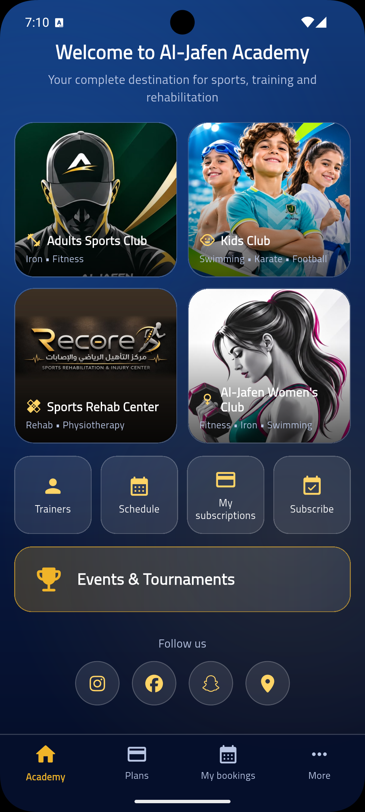
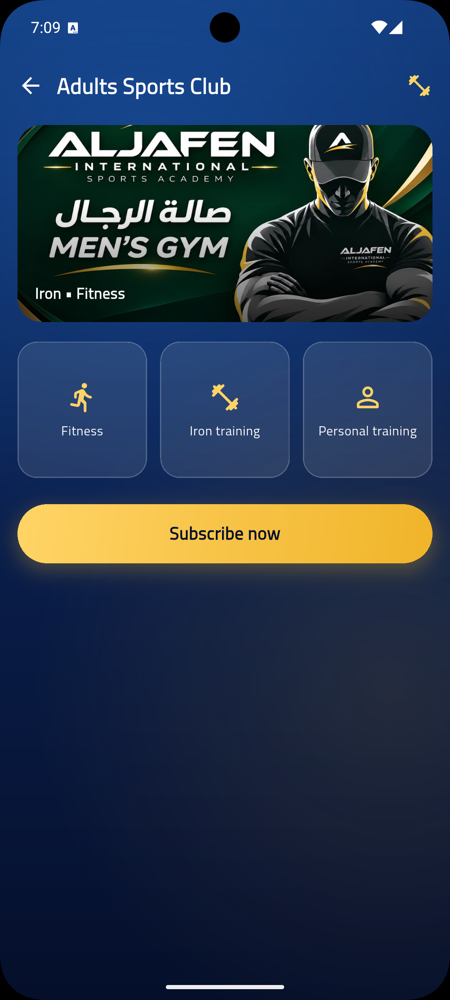
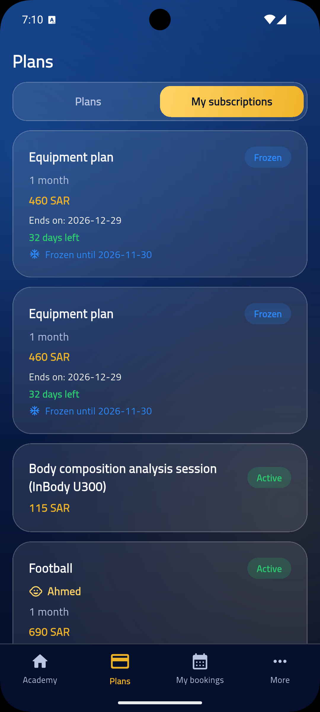
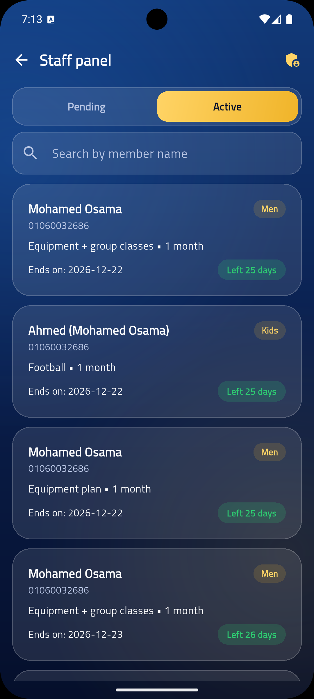

# JSA – Sports Academy Management App

A cross-platform mobile app (Android / iOS) and web admin built with **Flutter** and **Firebase** for a multi-club sports academy in Saudi Arabia. Arabic + English (RTL/LTR), with a custom navy & gold theme.

> Client project. Branding and data shown here are for portfolio purposes.

## Screenshots

| Home | Club | Plans |
|------|------|-------|
|  |  |  |

| My subscriptions | Bookings | Staff panel |
|------------------|----------|-------------|
|  |  |  |

## Features

**Members**
- Email/password sign-up and login, password reset, profile with photo, address and phone
- Change password with re-authentication
- Four clubs: Adults (men), Kids, Women, Rehab center
- Subscription plans with live prices, request and payment-method selection
- Kids profiles with automatic age categories (A / B / C) and per-child subscriptions
- Subscription freeze (once, 7 days) enforced by Firestore Security Rules
- Expiry alerts and one-tap renewal
- Session bookings (personal training, rehab) with date and time-slot picker
- Trainer schedules, announcements, offers and tournaments
- Arabic / English with full RTL support

**Staff and admin**
- Role-based access: member, trainer, receptionist, admin
- Review, activate or reject subscription requests; choose start date and payment method
- Active subscriptions list with expiry colors, search and freeze info
- Manage and confirm bookings, assign trainers
- Publish announcements, offers and tournaments (bilingual)

## Tech stack

- **Flutter / Dart** (Material 3), custom theme and animated backgrounds
- **Firebase Auth** and **Cloud Firestore** (real-time streams)
- **Firestore Security Rules** with role helpers (`get()` on the user document)
- Localization with `flutter_localizations`, custom string maps, Cairo font
- `image_picker`, `url_launcher`, `font_awesome_flutter`, `shared_preferences`

## Project structure

```
lib/
  core/       services (auth, plans, bookings, staff, freeze, schedule), theme, strings
  screens/    UI screens and tabs
  widgets/    reusable glass-style components
```

## Getting started

1. Install Flutter and create a Firebase project (Auth + Firestore).
2. Run `flutterfire configure` to generate `lib/firebase_options.dart`.
3. Enable Email/Password in Firebase Auth and publish the Firestore rules.
4. `flutter pub get` then `flutter run`.

## Roadmap

- Online payments (mada, Apple Pay, Tamara)
- Push notifications for expiry and bookings
- Web admin dashboard (prices, plans, reports)
- Smart-gate attendance integration

## Author

Mohamed Elekramy – [GitHub](https://github.com/Mohamedelekramy)
